<div align="center">

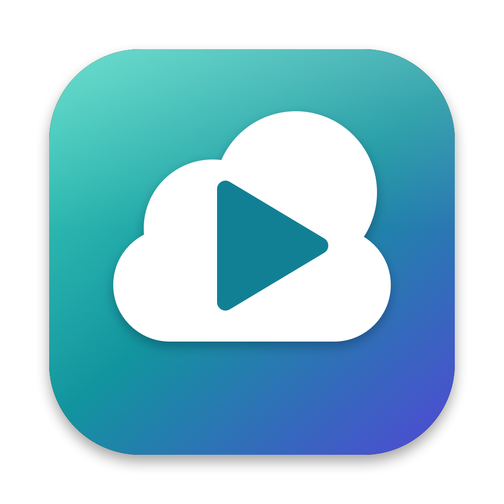

# TrueCloud for macOS

**Your TrueCloud gaming PC, one click away on your Mac.**<br>
Start the cloud PC, watch it boot, and play. Pairing with Moonlight happens on its own.

<p>
  <a href="https://github.com/Sammy970/TrueCloudMac/releases/latest"></a>
  
  
  
  
  
</p>

<p><a href="#download"><b>Download</b></a> &nbsp;·&nbsp; <a href="#the-whole-session-in-one-window">Screenshots</a> &nbsp;·&nbsp; <a href="#features">Features</a> &nbsp;·&nbsp; <a href="#getting-started">Getting started</a> &nbsp;·&nbsp; <a href="#how-it-works">How it works</a> &nbsp;·&nbsp; <a href="#project-layout">Project layout</a> &nbsp;·&nbsp; <a href="#made-by">Made by</a></p>

<p>
  <a href="https://discord.gg/GVDYtpWHps"></a><br>
  <b>Need help, found a bug, or have an idea?</b> Join the community: get help, report bugs and suggest features for TrueCloud.
</p>

</div>

> [!IMPORTANT]
> **Unofficial project.** This is an independent client built to show [TrueCloud](https://truecloud.in), with their permission.
> It is not made, endorsed or supported by TrueCloud. "TrueCloud" belongs to its owners; the icon and the teal theme are original.
> Use it with your own TrueCloud account, and follow TrueCloud's terms of service.

<br>

<p align="center">
  <picture><source media="(prefers-color-scheme: dark)" srcset=".github/screenshots/dark-login.png">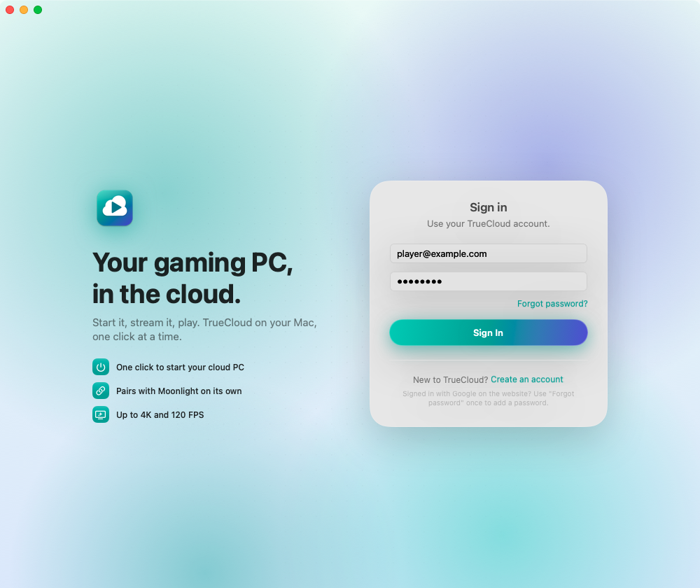</picture>
</p>

<br>

## The whole session in one window

The home screen is built around one question: what is my cloud PC doing right now?
A drawn monitor shows the answer, the track below it shows how far along you are, and there is only ever one main button.

<table>
  <tr>
    <td width="33%" valign="top">
      <picture><source media="(prefers-color-scheme: dark)" srcset=".github/screenshots/dark-step-idle.png">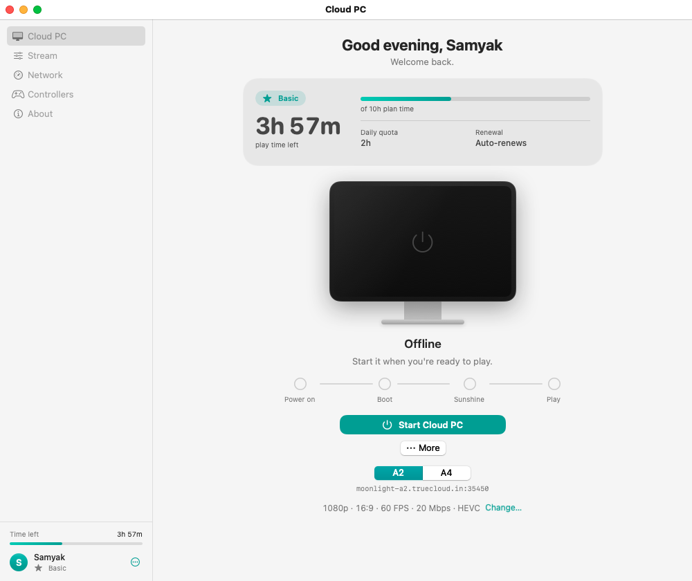</picture>
      <p align="center"><b>Offline</b><br><sub>One button to start.</sub></p>
    </td>
    <td width="33%" valign="top">
      <picture><source media="(prefers-color-scheme: dark)" srcset=".github/screenshots/dark-step-starting.png">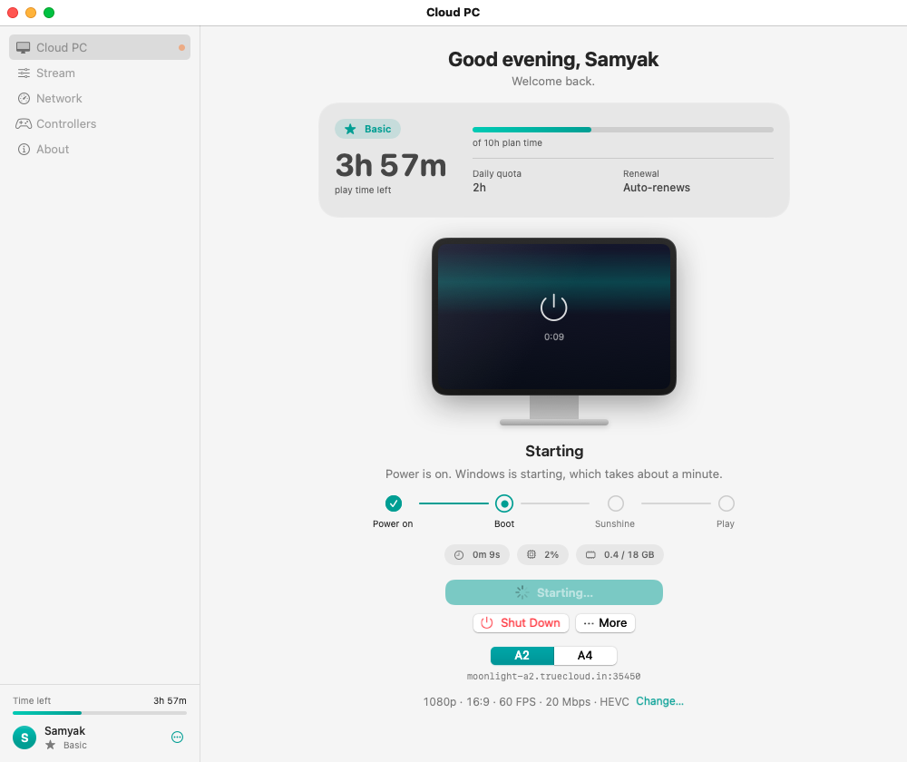</picture>
      <p align="center"><b>Starting</b><br><sub>TrueCloud powers on your rig.</sub></p>
    </td>
    <td width="33%" valign="top">
      <picture><source media="(prefers-color-scheme: dark)" srcset=".github/screenshots/dark-step-booting.png">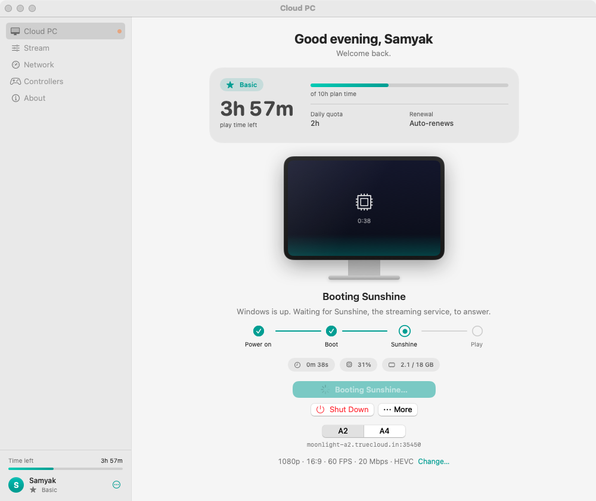</picture>
      <p align="center"><b>Booting</b><br><sub>Windows and Sunshine come up.</sub></p>
    </td>
  </tr>
  <tr>
    <td width="33%" valign="top">
      <picture><source media="(prefers-color-scheme: dark)" srcset=".github/screenshots/dark-step-ready.png">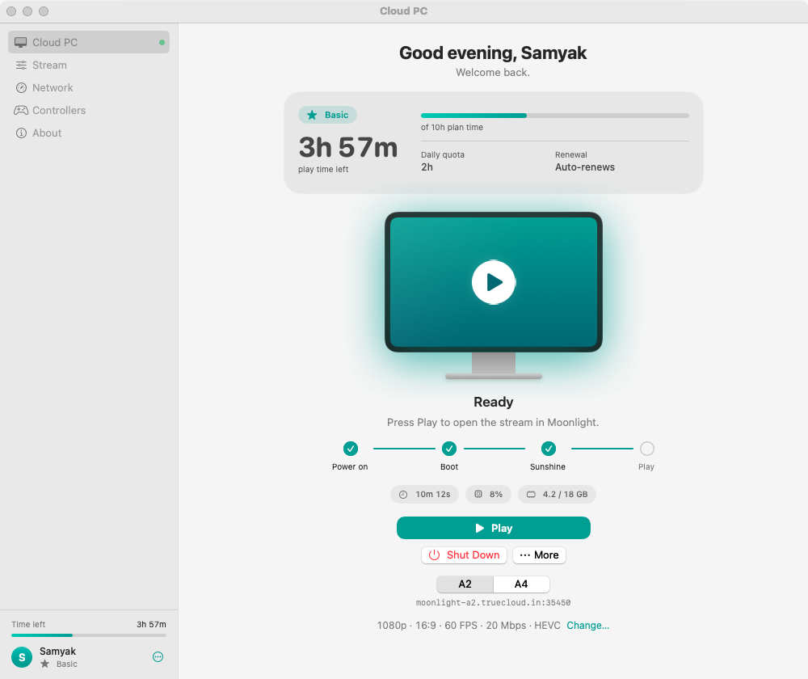</picture>
      <p align="center"><b>Ready</b><br><sub>Press Play when you are.</sub></p>
    </td>
    <td width="33%" valign="top">
      <picture><source media="(prefers-color-scheme: dark)" srcset=".github/screenshots/dark-step-pairing.png">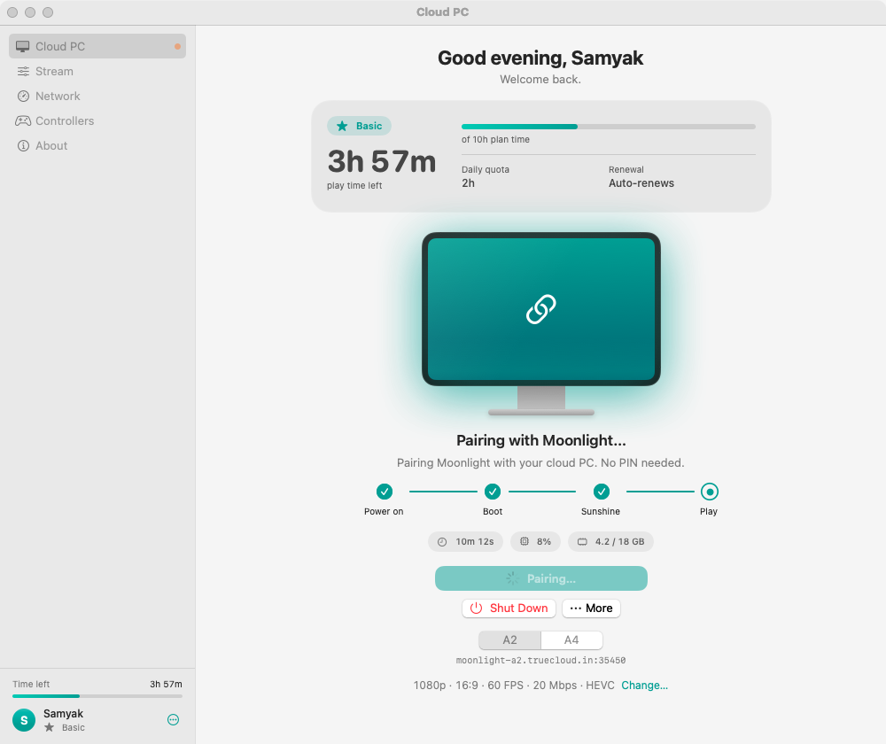</picture>
      <p align="center"><b>Pairing</b><br><sub>Moonlight pairs itself. No PIN to type.</sub></p>
    </td>
    <td width="33%" valign="top">
      <picture><source media="(prefers-color-scheme: dark)" srcset=".github/screenshots/dark-step-streaming.png">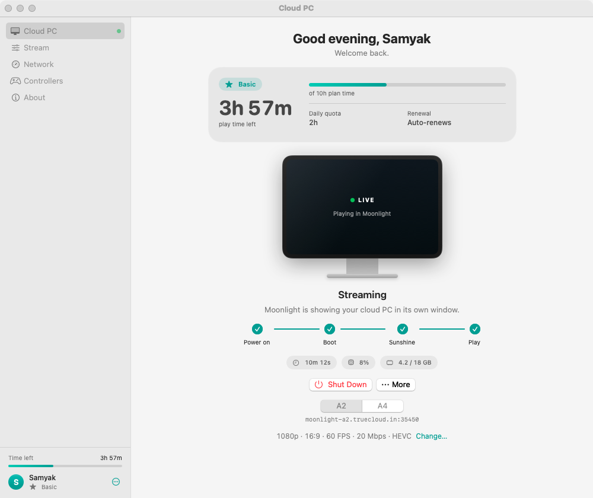</picture>
      <p align="center"><b>Streaming</b><br><sub>You're playing. The app waits in the background.</sub></p>
    </td>
  </tr>
</table>

## Your plan, and what your cloud PC is doing

The plan card now shows the date your plan ends, and while the cloud PC runs you can see how much data it is moving.

<table>
  <tr>
    <td width="50%" valign="top">
      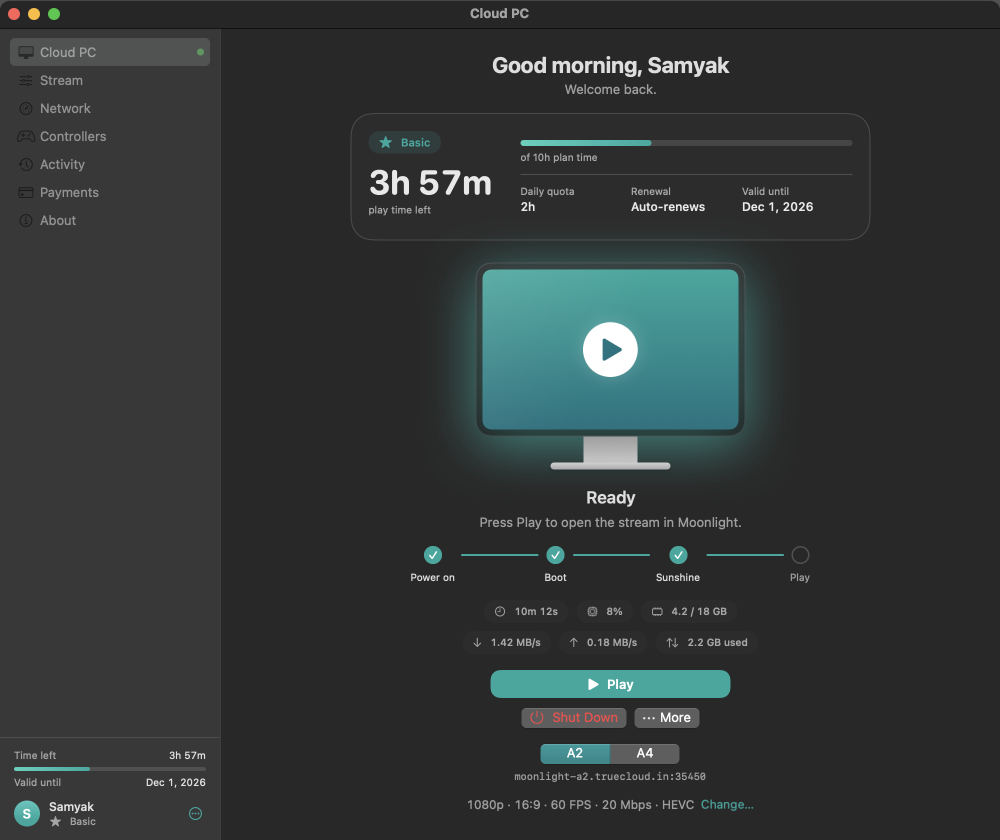
      <p align="center"><b>Valid until, and network usage</b><br><sub>Download, upload and the data used so far, like the dashboard shows.</sub></p>
    </td>
    <td width="50%" valign="top">
      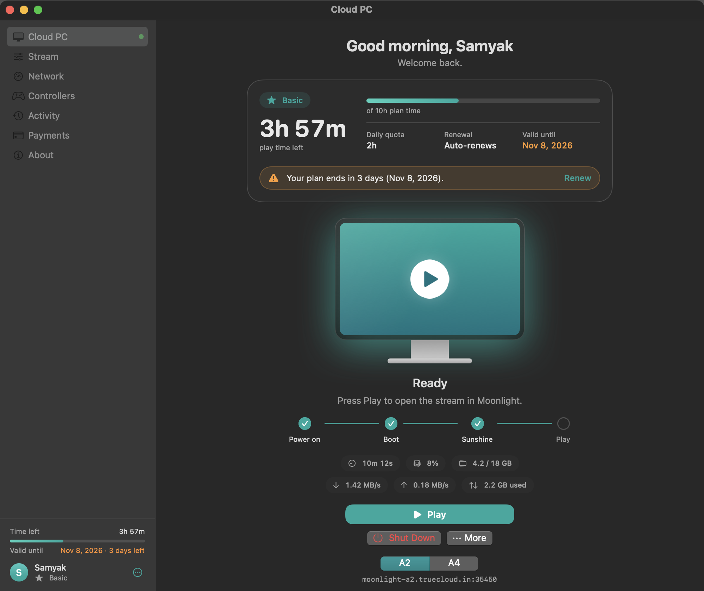
      <p align="center"><b>Ending soon</b><br><sub>A warning when fewer than 5 days are left, with a Renew link.</sub></p>
    </td>
  </tr>
</table>

If the plan has ended, a red banner says so, and Start explains why it can't start instead of failing.

## Activity and payments

<table>
  <tr>
    <td width="50%" valign="top">
      <picture><source media="(prefers-color-scheme: dark)" srcset=".github/screenshots/dark-activity.png">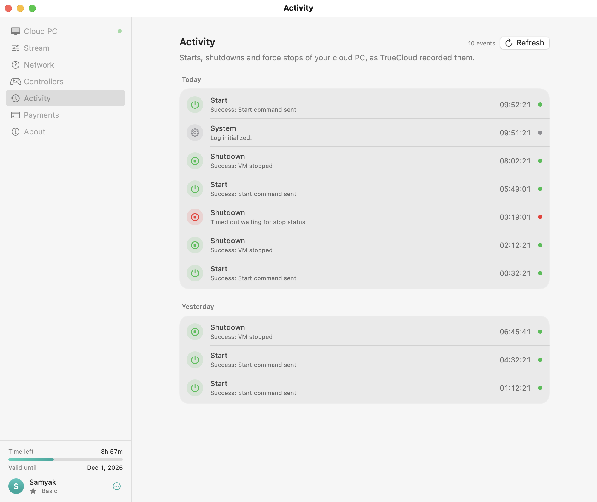</picture>
      <p align="center"><b>Activity</b><br><sub>Every start, shutdown and force stop, and how it went.</sub></p>
    </td>
    <td width="50%" valign="top">
      <picture><source media="(prefers-color-scheme: dark)" srcset=".github/screenshots/dark-payments.png">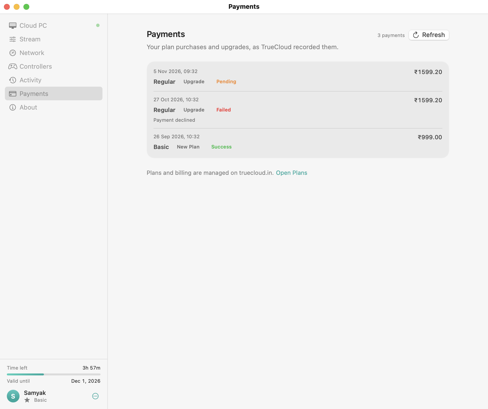</picture>
      <p align="center"><b>Payments</b><br><sub>Your purchases and upgrades, and why a payment failed.</sub></p>
    </td>
  </tr>
</table>

The activity log is TrueCloud's own record of your cloud PC's power events, so it is also the quickest way to show their support exactly what happened
(for example a shutdown that "timed out waiting for stop status"). Your IP address, which TrueCloud stores with each entry, is never shown.

## Stream settings that explain themselves

<table>
  <tr>
    <td width="42%" valign="top">
      <p>Grouped like System Settings, with the numbers that matter right under each choice.</p>
      <ul>
        <li><b>Display:</b> 720p to 4K, 16:9, 16:10 or 21:9, and fullscreen.</li>
        <li><b>Performance:</b> 30, 60 or 120 FPS and the bitrate, with the most data you'll use per hour.</li>
        <li><b>Codec &amp; audio:</b> HEVC for a sharper picture at the same bitrate.</li>
      </ul>
      <p>The home screen always shows a one-line summary such as <code>1080p · 16:9 · 60 FPS · 20 Mbps · HEVC</code>.</p>
    </td>
    <td width="58%" valign="top">
      <picture><source media="(prefers-color-scheme: dark)" srcset=".github/screenshots/dark-settings.png">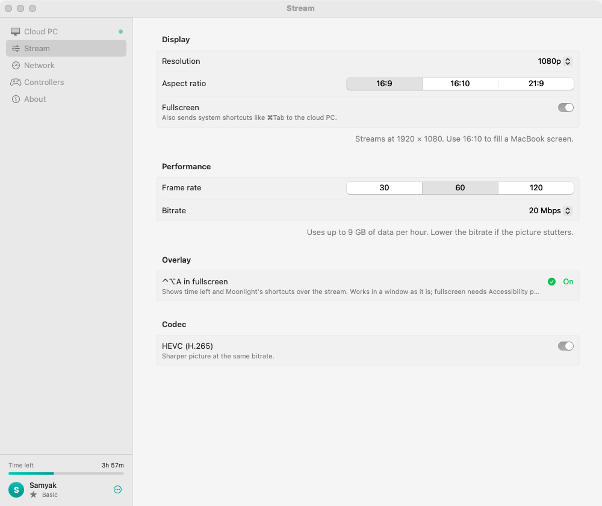</picture>
    </td>
  </tr>
</table>

## Check your connection before you start

<table>
  <tr>
    <td width="58%" valign="top">
      <picture><source media="(prefers-color-scheme: dark)" srcset=".github/screenshots/dark-network.png">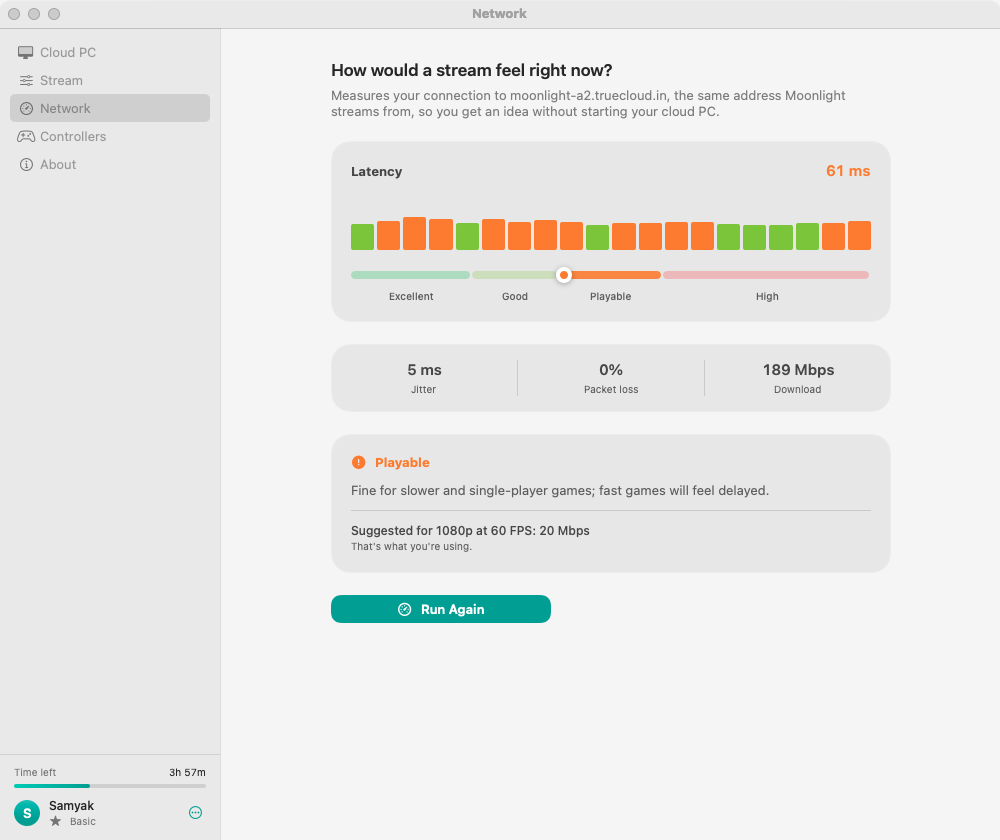</picture>
    </td>
    <td width="42%" valign="top">
      <p>The <b>Network</b> pane tells you how a stream would feel without starting the cloud PC.</p>
      <ul>
        <li><b>Latency</b> to the gateway Moonlight streams from. Twenty samples fill in live and a marker settles on Excellent, Good, Playable or High.</li>
        <li><b>Jitter, packet loss and download speed.</b></li>
        <li><b>A plain verdict</b> and the bitrate your resolution and frame rate actually need.</li>
      </ul>
    </td>
  </tr>
</table>

## Check your controller

<table>
  <tr>
    <td width="42%" valign="top">
      <p>The <b>Controllers</b> pane shows whether a controller will work before you start the cloud PC.</p>
      <ul>
        <li><b>A drawn controller that mirrors yours:</b> buttons light up, the sticks move and the triggers fill as you pull them.</li>
        <li><b>Ready to play, or not:</b> each controller is checked against the controllers Moonlight recognises on a Mac.</li>
        <li><b>The details:</b> its ID, Bluetooth or USB, battery, exact stick values (handy for spotting drift), and a vibration test.</li>
      </ul>
    </td>
    <td width="58%" valign="top">
      <picture><source media="(prefers-color-scheme: dark)" srcset=".github/screenshots/dark-controllers.png">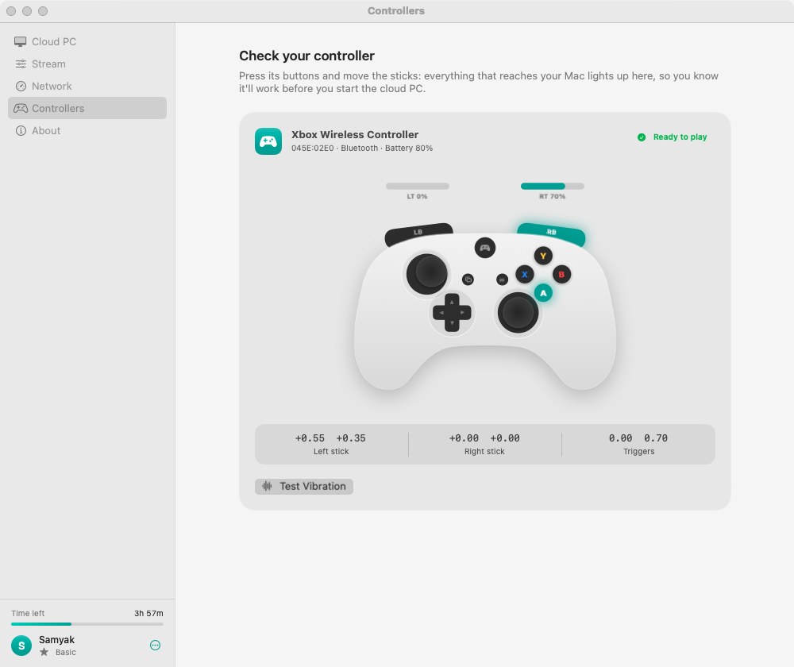</picture>
    </td>
  </tr>
</table>

## Light and dark

The app follows your Mac's appearance. Teal is the only accent colour.

<table>
  <tr>
    <td width="50%"></td>
    <td width="50%">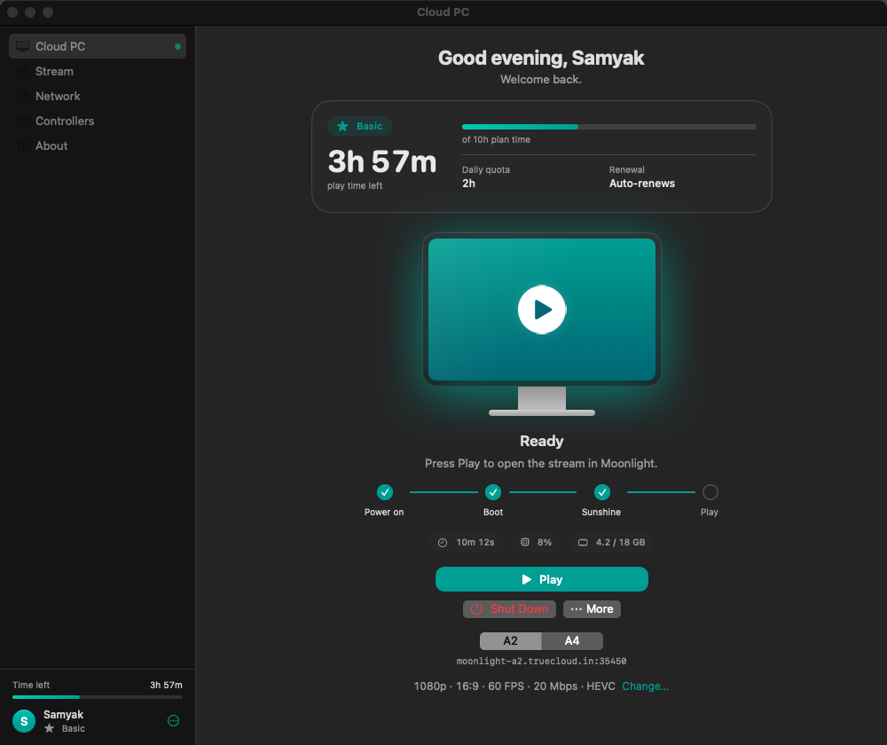</td>
  </tr>
</table>

## Features

- **Sign in** with email and password. The password is never stored; only the refresh token is, in the macOS Keychain.
- **Your plan on the home screen:** plan name, play time left this month, daily quota, renewal and the date the plan ends, with a warning when it is close and a clear message when it has ended.
- **Network usage** while the cloud PC runs: download and upload speed, and the data used so far.
- **Activity** (every start, shutdown and force stop with its result) and **Payments** (purchases, upgrades and failures).
- **One-click cloud PC.** Start it, watch the four-step track (Power on, Boot, Sunshine, Play), then press Play.
- **Automatic pairing.** Moonlight shows its own PIN and the app hands it to TrueCloud, so there is nothing to type.
  If the rig doesn't know this Mac, the app pairs it on the first Play.
- **Shut Down** with a confirmation, plus **Force Stop** and **Unpair All Devices** behind **More**, both confirmed.
- **A2 or A4 endpoint picker**, remembered between launches.
- **Network check** and **Controller check** without starting the cloud PC.
- **In-stream overlay:** press **⌃⌥A** during a stream for a small card with time left, live latency and
  Moonlight's own shortcuts. It warns you when the connection gets busy and when plan time is running out.
- **Works for every account.** The app reads your own rig's address and Moonlight port from your TrueCloud profile, as the website does, so it doesn't assume anyone else's. It keeps that profile fresh while it is open.
- **Readable errors:** wrong password, expired session, an ended plan, no plan time left, a rig that is still being built, TrueCloud pausing starts, a cooldown.
- **Liquid Glass on macOS 26,** with a frosted fallback on earlier versions.

Google sign-in, which the website also offers, isn't supported. Use "Forgot password?" once to add a password to a Google-created account.

## Download

**[Download TrueCloud for Mac 0.1.2](https://github.com/Sammy970/TrueCloudMac/releases/latest)**: no building needed.

1. Install [Moonlight](https://moonlight-stream.org), which does the streaming: `brew install --cask moonlight`.
2. Unzip, drag **TrueCloud** to Applications and open it.
3. The first time, macOS can't verify the app (it isn't notarized), so go to **System Settings → Privacy & Security →
   Open Anyway**. Only once.

## Getting started

To build it yourself instead:

You need macOS 13 or later, the Xcode toolchain, and [Moonlight](https://moonlight-stream.org):

```sh
brew install --cask moonlight
```

Then run or build the app:

```sh
export DEVELOPER_DIR=$(ls -d /Applications/Xcode*.app | head -1)/Contents/Developer
swift run                                         # run in development
scripts/build-app.sh                              # build/TrueCloud.app, signed with your Apple Development cert if present, else ad-hoc
scripts/build-app.sh --bundle-moonlight --adhoc   # also embed Moonlight in the bundle
scripts/make-release.sh                           # dist/TrueCloud-<version>-mac.zip, ad-hoc signed
```

An app you build and share isn't notarized, so macOS asks for **System Settings → Privacy & Security → Open Anyway** the first time.

<details>
<summary><b>Preview mode</b>, for working on the UI</summary>
<br>

Debug builds can open any screen with a sample account, without touching your Keychain or the network.
This is how the screenshots above were made.

```sh
TRUECLOUD_PREVIEW=home:ready swift run
TRUECLOUD_PREVIEW=login TRUECLOUD_APPEARANCE=light TRUECLOUD_SNAPSHOT=login.png swift run
```

| Variable | Values |
|---|---|
| `TRUECLOUD_PREVIEW` | `login`, or `home:<phase>` with phase `checking`, `idle`, `starting`, `booting`, `ready`, `pairing`, `streaming` or `shutting`. Add `:stream`, `:network`, `:about` or `:controllers:sample` for a pane, `:overlay` for the overlay, or `:confirm-shutdown`, `:confirm-force`, `:confirm-unpair`, `:notice` for a dialog. Add `:activity` or `:payments` for those panes, and `:expiring` or `:expired` to see the plan-end banners. |
| `TRUECLOUD_APPEARANCE` | `light` forces light mode |
| `TRUECLOUD_SNAPSHOT` | Saves the window as a PNG after it settles, then quits (`TRUECLOUD_SNAPSHOT_DELAY=<seconds>` waits longer) |

</details>

## Tests

```sh
swift test
```

`Tests/KitTests` covers the networking module with fixtures (Firestore and RSC parsing, Server Action request shapes, the action-ID
resolver, Firebase requests and error mapping, retrying a stale ID, per-account ports, the activity log, payments and network speeds) and two read-only live checks, which skip when offline.
No test starts, stops or shuts down a rig, unpairs a device or sends a PIN.

## How it works

```
Sign in ──▶ Start Cloud PC ──▶ boot ──▶ Sunshine answers ──▶ ready
                                                               │
                                                             Play
                                                               │
                              pair if needed (PIN handed to Sunshine) ──▶ Moonlight stream
```

TrueCloud has no public API; the app uses the same endpoints as its website, and they can change without notice.

| Need | How |
|---|---|
| Sign in and refresh | Firebase REST (`signInWithPassword`, token refresh) with the web app's public API key |
| Profile and plan | Firestore REST, `users/<uid>`, with the ID token: the rig's host and `moonlight_port`, plan, time left and end date |
| Rig status | Server Action `getVmStatus` |
| Start, shut down, force stop | Server Actions `startVm`, `shutdownVm`, `stopVm` |
| Pair PIN, unpair | Server Actions `sendPin`, `unpairAllDevices`; after the first accepted PIN the app sets `hasPairedBefore` on your profile, as the dashboard does |
| Activity | Firestore `vm_logs/<vmid>-<uid>` |
| Payments | Firestore `transactions/<uid>` |
| Network usage | The `netin` and `netout` counters in `getVmStatus`, turned into MB/s between polls |
| Starts paused by TrueCloud | `GET /api/system-controls` (public) |
| Streaming | The Moonlight command line: `Moonlight pair <host> --pin N`, then `Moonlight stream <host> Desktop` |

Server Action IDs change whenever TrueCloud deploys, so `ActionResolver` reads them from the rig page's JavaScript, caches them
and looks them up again after a failed call.

**Pairing.** If Moonlight reports the host as unpaired, the app starts `pair`, waits for Moonlight to show its PIN, sends that PIN to
TrueCloud and keeps resending until Moonlight reports pairing finished, then streams.

## Project layout

| Path | What's there |
|---|---|
| `Sources/Kit/` | `TrueCloudKit` (Foundation only): Firebase, Firestore, RSC parsing, the action resolver and the rig API |
| `Sources/Shared/` | Sign-in and Keychain, the session state machine, themes and the views shared with the iPhone app |
| `Sources/Mac/Views/` | Sidebar, Cloud PC screen, stream settings, network, controller, activity and payments panes |
| `Sources/Mac/Stream/` | The Moonlight runner and driver, and the in-stream overlay |
| `Sources/Mac/Controllers/` | Controller monitor and the controllers Moonlight recognises |
| `scripts/` | `build-app.sh`, `make-release.sh`, `make-icon.swift` (draws the icon), `update-controller-db.sh` |
| `PRODUCT.md`, `DESIGN.md` | Who the app is for, and the design rules the UI follows |

`Sources/Kit/` and `Sources/Shared/` are also used by the iPhone app, TrueCloud for iPhone.

## Made by

<table>
  <tr>
    <td width="96" valign="middle"><a href="https://github.com/Sammy970"></a></td>
    <td valign="middle">
      <b>Samyak Jain</b><br>
      <sub>Designed and built TrueCloud for Mac and iPhone, from reading the website's own requests to the last animation.</sub><br><br>
      <a href="https://github.com/Sammy970"></a>
      <a href="https://x.com/Sammy_970"></a>
    </td>
  </tr>
</table>

<p align="center">
  <picture><source media="(prefers-color-scheme: dark)" srcset=".github/screenshots/dark-about.png">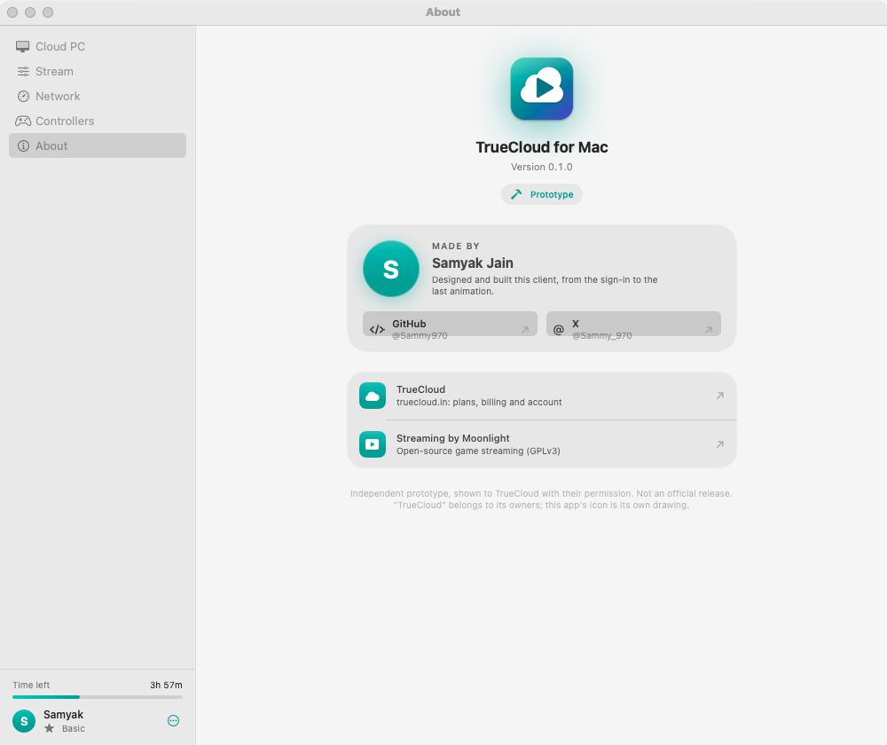</picture>
  <br><sub>The same credits live in the app, under <b>About</b>.</sub>
</p>

## Notes

Unofficial client, not affiliated with TrueCloud. Streaming uses the official
[Moonlight](https://github.com/moonlight-stream/moonlight-qt) app (GPLv3).
